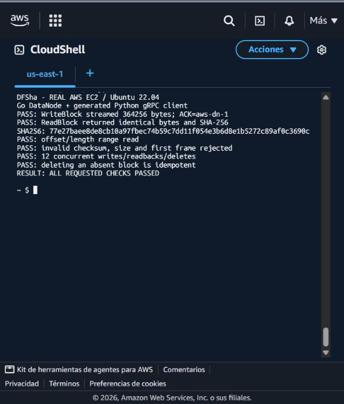
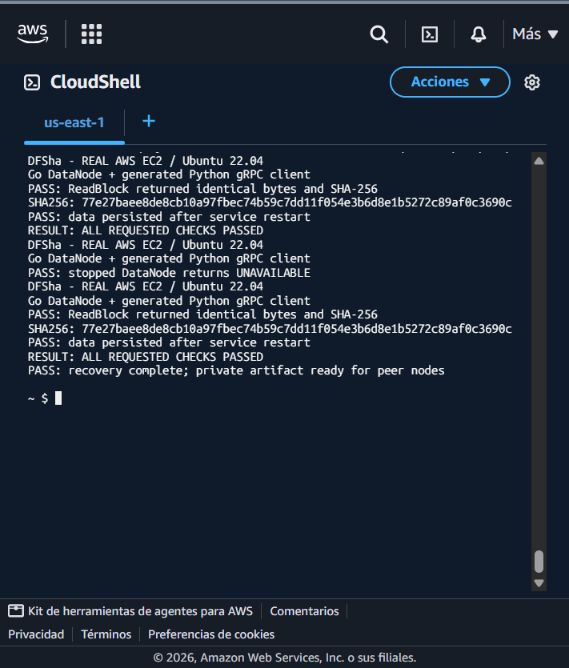
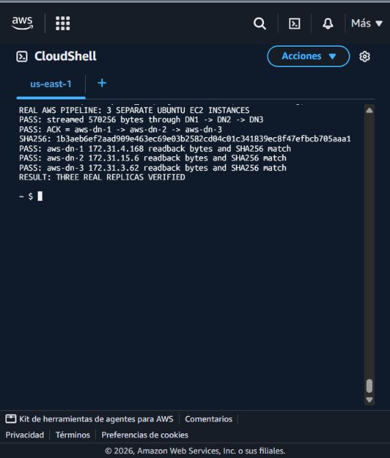
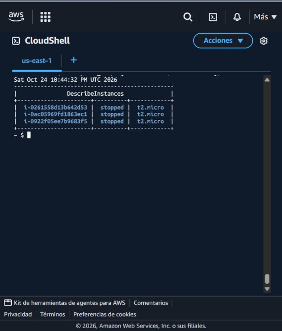

# Pruebas del DataNode en AWS

Fecha de ejecución: 24 de octubre de 2026. Entorno: AWS Academy Learner Lab,
región `us-east-1`.

Código probado: commit
[`bc5f0f5`](https://github.com/FelipeOchoaL/DFSha/commit/bc5f0f570cfc38f46a464f8697c795ea78901575),
de la rama `carlosVlast`.

Se ejecutó el DataNode de Go en tres instancias EC2 independientes con Ubuntu
Server 22.04 y tipo `t2.micro`. Un cliente Python generado desde
`proto/datanode.proto` comprobó las respuestas gRPC y comparó los datos leídos
con los originales. Los puertos del DataNode quedaron restringidos a la red
de las instancias de prueba.

## Resultados

| Comprobación | Resultado |
| --- | --- |
| Compilación, `go vet` y pruebas Go en EC2 | Correctos |
| Escritura por streaming y lectura completa | Bloque de 364.256 bytes recuperado sin cambios |
| Integridad | SHA-256 coincidente entre el contenido original y el leído |
| Lectura parcial | Offset 19 y longitud 173 con el contenido esperado |
| Validación de solicitudes | Rechazados checksum incorrecto, tamaño incorrecto y primer mensaje inválido |
| Concurrencia | 12 tareas de escritura, lectura y borrado con seis trabajadores, sin fallos |
| Borrado de bloque inexistente | Respuesta idempotente, `deleted=false` |
| Persistencia | Lectura del bloque original después de reiniciar el servicio, sin volver a escribirlo |
| Caída y recuperación | `UNAVAILABLE` con el servicio detenido; lectura correcta al iniciarlo otra vez |
| Pipeline entre tres EC2 | Bloque de 570.256 bytes enviado por DN1 -> DN2 -> DN3 |
| Confirmaciones | ACK de `aws-dn-1`, `aws-dn-2` y `aws-dn-3`, en ese orden |
| Lectura de cada réplica | Contenido y SHA-256 coincidentes en las tres máquinas |

Los bloques utilizados fueron:

- Individual: `aws-carlos-proof-20261024`, SHA-256
  `77e27baee8de8cb10a97fbec74b59c7dd11f054e3b6d8e1b5272c89af0c3690c`.
- Replicado: `aws-carlos-pipeline-proof-20261024`, SHA-256
  `1b3aeb6ef2aad909e463ec69e03b2582cd04c01c341839ec8f47efbcb705aaa1`.

## Capturas

### Escritura, lectura y concurrencia

Los mensajes `PASS` se imprimieron después de verificar las respuestas del
servidor mediante aserciones del cliente Python.

### Persistencia y recuperación

Se reinició el servicio y se volvió a leer el bloque existente. Después se
detuvo, se comprobó la respuesta `UNAVAILABLE` y se inició nuevamente para
verificar la recuperación del acceso a los mismos datos.

### Pipeline entre tres máquinas

La escritura obtuvo las tres confirmaciones y cada DataNode devolvió los
mismos bytes y checksum al leer su réplica.

### Apagado al terminar

A las 17:44:32 de Colombia, AWS confirmó `stopped` para las tres instancias:

| Nodo | Instancia |
| --- | --- |
| `aws-dn-1` | `i-0261558d13b642d53` |
| `aws-dn-2` | `i-0922f05ee7b9683f5` |
| `aws-dn-3` | `i-0ac05969fd1863ec1` |

Después se cerró la sesión de AWS Academy con `End Lab` y se confirmó el estado
`Terminated` del laboratorio. Los discos se conservaron para recuperar el entorno;
su almacenamiento puede seguir consumiendo presupuesto del laboratorio.

## Alcance

Esta ejecución verifica el almacenamiento, las operaciones gRPC del DataNode y
su pipeline con tres máquinas dentro de la misma zona de disponibilidad. Las
pruebas se prepararon para DFSha; no son una reproducción literal de los
laboratorios de Drupal o Docker.

Quedan pendientes la integración con el NameNode, registro, heartbeats,
`BlockReceived`, recuperación automática de réplicas, failover, tokens, TLS y
cifrado de bloques en la aplicación. El disco EC2 cifrado no equivale a implementar
cifrado en el protocolo o en los bloques. Estas pruebas no certifican el DFS
completo ni tolerancia a la caída de una zona de disponibilidad.
